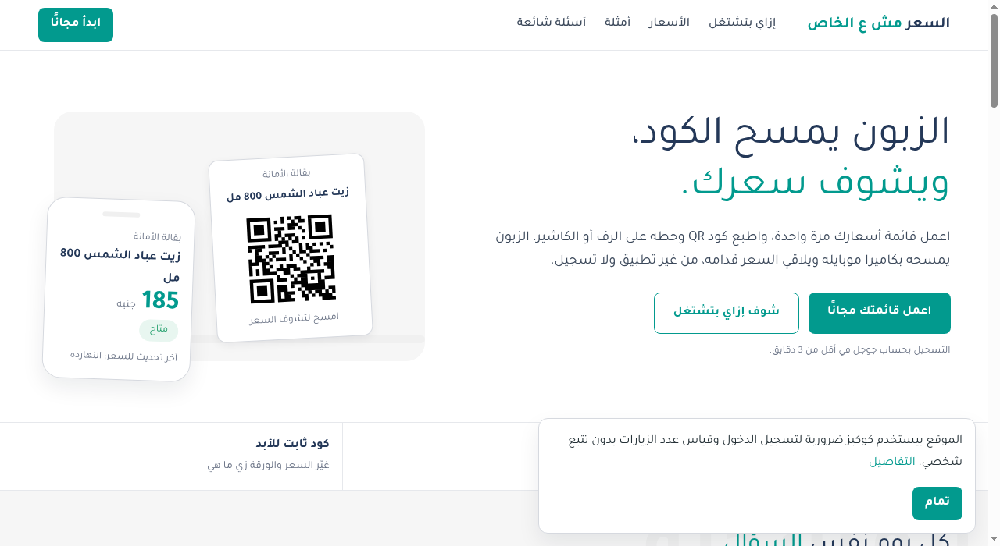
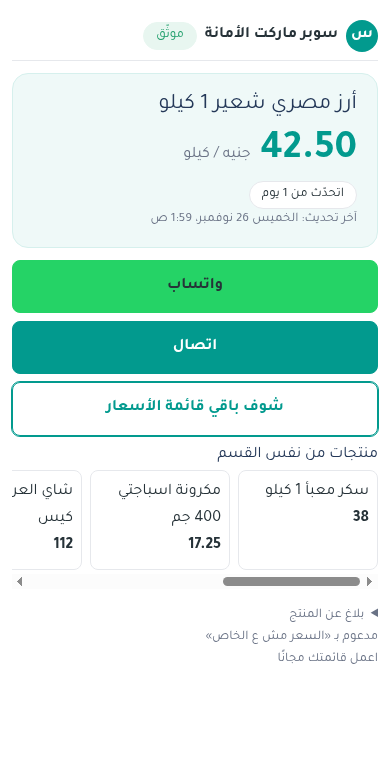
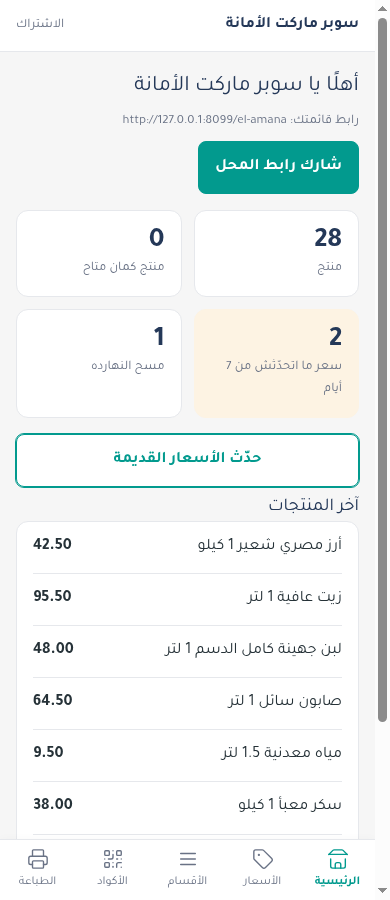
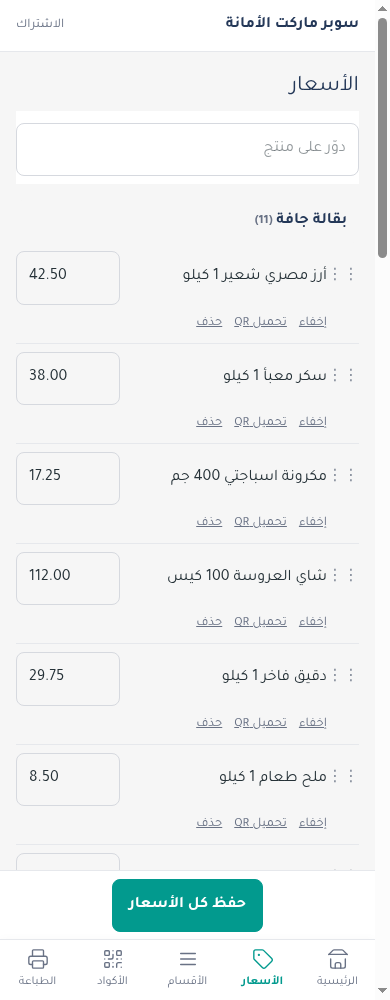
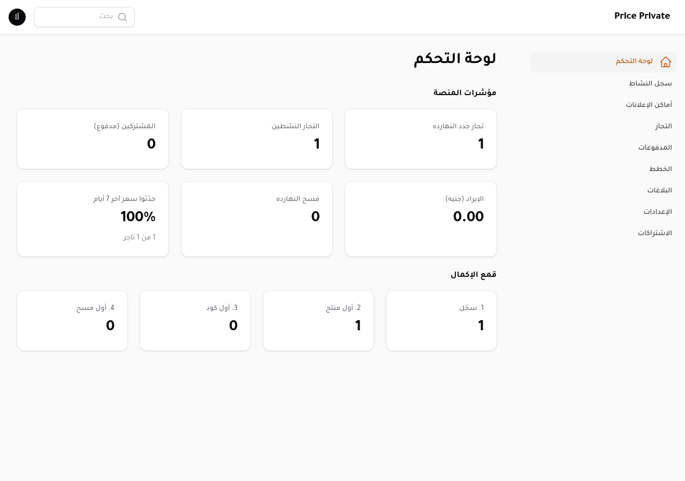
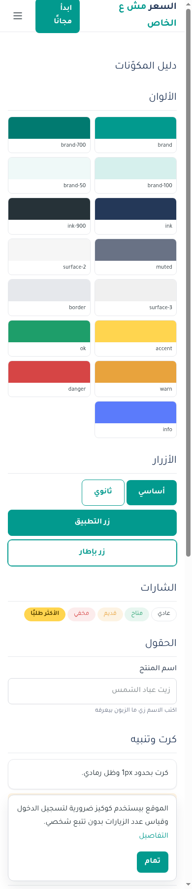

# priceprivate ("السعر مش ع الخاص")

A Laravel app for Egyptian small shops. A merchant keeps one price list online, edits prices from a phone in seconds, and shares it through a **permanent link and a permanent QR code**. A customer scans the code and sees the current price right away, with no app and no sign-up.

> Branch note: this README describes the `instinct-work` branch. It is a working build against `SRS.md`, not a finished product. See [Known limits](#known-limits).

## The problem

Shop prices change often and printed price tags go stale. Reprinting is slow and costs money. Here the QR code on the shelf never changes. Only the price behind it does.

## Tech stack

| Part | Version (from `composer.lock` / `package.json`) |
|---|---|
| PHP | 8.2+ required by `composer.json`; developed and tested on 8.4 |
| Laravel | 12.73 |
| Filament (admin panel at `/admin`) | 5.12 |
| Livewire | 4.4 |
| Socialite (Google login, Facebook behind a setting) | 5.33 |
| QR generation (`endroid/qr-code`) | 6.1 |
| PDF print sheets and invoices (`mpdf/mpdf`) | 8.3 |
| Vite / Tailwind CSS | 7 / 4 |
| Database | SQLite (default, tests) or MySQL/MariaDB |

The UI is Arabic (Egyptian), right to left. Sortable drag-sorting loads SortableJS from a CDN.

## Requirements

- PHP 8.2+ with `intl`, `mbstring`, `gd` (or imagick), `pdo_sqlite` and/or `pdo_mysql`. The admin panel and its tests need `intl`.
- Composer 2
- Node.js and npm (for `npm run build`)
- Optional: MySQL or MariaDB

## Install and run

```bash
git clone https://github.com/Ahmed225Z/priceprivate.git
cd priceprivate
git checkout instinct-work

composer install
cp .env.example .env
php artisan key:generate

touch database/database.sqlite      # only for the default SQLite setup
php artisan migrate --seed

npm install
npm run build

php artisan serve                    # http://127.0.0.1:8000
php artisan queue:work               # separate terminal, sends the payment confirmation email
```

Seeding creates plans, ad slots, settings, an admin user (`admin@priceprivate.test`) and, in the `local` or `staging` environment, a demo merchant (`demo@priceprivate.test`, store slug `el-amana`).

Sign-in is **Google only**. There are no passwords. To log in you need Google OAuth credentials (below), and the Google account email must match the seeded user.

## Environment variables

Copy `.env.example` to `.env`. Never commit `.env`.

| Variable | Purpose |
|---|---|
| `APP_NAME`, `APP_ENV`, `APP_KEY`, `APP_DEBUG`, `APP_URL` | Standard Laravel. `APP_KEY` comes from `key:generate`. |
| `APP_LOCALE`, `APP_FALLBACK_LOCALE` | Language. The UI is written for `ar`. |
| `DB_CONNECTION` | `sqlite` (default) or `mysql`. For MySQL also set `DB_HOST`, `DB_PORT`, `DB_DATABASE`, `DB_USERNAME`, `DB_PASSWORD`. |
| `QUEUE_CONNECTION` | `database` by default. |
| `MAIL_MAILER` and `MAIL_*` | `log` by default, so emails are written to the log. |
| `GOOGLE_CLIENT_ID`, `GOOGLE_CLIENT_SECRET`, `GOOGLE_REDIRECT_URI` | Google login. |
| `FACEBOOK_CLIENT_ID`, `FACEBOOK_CLIENT_SECRET`, `FACEBOOK_REDIRECT_URI` | Only if Facebook login is switched on in settings. |
| `PAYMENT_GATEWAY` | `mock` (default). No real gateway is implemented. |
| `PAYMENT_MOCK_SECRET` | HMAC secret for the mock gateway webhook. Set your own value. |

## Main features

- **Merchant**: Google login, onboarding, categories, products (image upload converted to WebP), bulk price editor with search and per-category drag-sort, product limit per plan, soft delete.
- **QR studio**: live preview, PNG/SVG download, default target (product, category or store), scan counting.
- **Print studio**: A4 label sheet, store card, shelf talker, table stand and poster, as PDF.
- **Public pages**: product page by code, store and category pages, reports (abuse) form, `robots.txt`, `sitemap.xml`, noindex on hidden or state pages, security headers.
- **Subscriptions and payments**: plans, subscription page, mock gateway with HMAC webhook (idempotent), grace period, auto-hide and restore of products, invoice PDF, queued confirmation email.
- **Admin (`/admin`, Filament)**: merchants (suspend, reactivate, impersonate with banner and log), reports, payments (manual activation), subscriptions, ad slots, plans, settings, activity log, health and funnel widgets. Admins see everything. Moderators see only Reports.
- **Marketing site**: home, how it works, pricing, examples, FAQ, contact, terms and privacy (placeholders), cookie banner, and `/styleguide` (noindex) listing the components.

## Screenshots

Taken from a local run against seeded demo data. Real pictures of the running app, not mockups.

| | |
|---|---|
|  Home |  Public product page |
|  Merchant dashboard |  Price editor |
|  QR studio |  Admin dashboard |
|  Styleguide at 390px | |

## Tests

The suite has 84 tests. Four admin tests need PHP `intl`.

**SQLite (default, in memory, per `phpunit.xml`):**
```bash
php artisan test
```
Result seen here with a PHP build that had `pdo_sqlite` but no `intl`: all pass except the 4 admin tests. Run them on a PHP with both extensions to get the full suite.

**MariaDB / MySQL:**
```bash
mysql -e "CREATE DATABASE pp_test"
DB_CONNECTION=mysql DB_HOST=127.0.0.1 DB_PORT=3306 DB_DATABASE=pp_test \
DB_USERNAME=root DB_PASSWORD= php artisan test
```
Result seen here on MariaDB 10.11.9: 84 passed (1311 assertions). Adjust host, port and credentials to your server.

## Known limits

Verified: the automated tests above and screenshots from a local run. **Not verified or not built:**

- Real payment gateways (Paymob/Fawry). Only the mock gateway exists.
- Scanning a printed code with a real phone.
- A real Google login (no credentials were available).
- MySQL 8 itself. Tests ran on MariaDB 10.11 as a stand-in.
- 3G speed, Lighthouse and LCP measurements, and a page-size check.
- SortableJS from the CDN was never run in a real browser session.
- Price editor is a plain form plus JS, not a Livewire component.
- Only about 10 inline icons, no full icon set. No 320px audit of every page.
- Terms and privacy are placeholders and need real legal text.
- No real photos or illustrations.

Status per round is kept in [INSTINCT_WORK.md](INSTINCT_WORK.md). The spec is [SRS.md](SRS.md) and [PROJECT_SPEC.md](PROJECT_SPEC.md). The original Arabic README is kept at `docs/README.ar-original.md`.

## ملخص بالعربي

«السعر مش ع الخاص» منصة للتجار الصغار في مصر: التاجر يعمل قائمة أسعار واحدة ويحدّثها من موبايله، ويطبع كود QR ثابت. الزبون يمسح الكود ويشوف السعر الحالي من غير تطبيق ولا تسجيل. المشروع Laravel 12 مع لوحة إدارة Filament وواجهة عربية RTL. التشغيل: `composer install` ثم `npm install && npm run build` ثم `php artisan migrate --seed` ثم `php artisan serve`. الاختبارات: 84 اختبار نجحوا على MariaDB. الدخول بجوجل فقط، والدفع الحقيقي (Paymob/Fawry) لسه ما اتعملش، ونصوص الشروط والخصوصية مكانها مؤقت. باقي الحدود في قسم Known limits.

## License

No license file is included in this repository.
